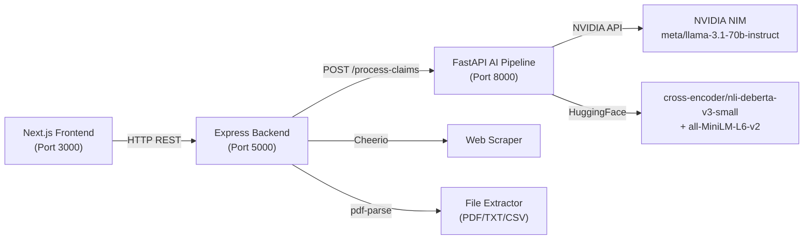

# Project Analysis: Contradictory Knowledge Resolver (CRN)

## Overview

This is a **full-stack AI application** designed to detect and resolve contradictions across multiple information sources. It features a 3-tier architecture — a Next.js frontend, a Node.js/Express backend orchestrator, and a Python FastAPI AI microservice — powered by NVIDIA NIM APIs and HuggingFace NLP models.

---

## Architecture



---

## Layer-by-Layer Breakdown

### 1. Frontend — `frontend/` (Next.js 16 + React 19 + TypeScript)

| File | Purpose |
|---|---|
| `src/app/page.tsx` | Hero landing page with animated CTA |
| `src/app/analyzer/page.tsx` | 4-tab input wizard (Files / Website / Links / Manual Text) |
| `src/app/results/page.tsx` | Results display: conclusion, confidence bar, source ranking, AI reasoning |
| `src/app/settings/page.tsx` | Static settings UI (profile, API key, model selection) |
| `src/app/text/page.tsx` | Additional text entry page |
| `src/components/Navbar.tsx` | Navigation bar |

**Key Libraries:** `framer-motion` (animations), `lucide-react` (icons), `recharts` (charts), `axios` (HTTP), `tailwindcss` v4

**Data Flow:** Results are passed via `sessionStorage` from Analyzer → Results page.

---

### 2. Backend Orchestrator — `backend/` (Node.js + Express 5 + TypeScript)

| File | Purpose |
|---|---|
| `src/index.ts` | Express server bootstrap (port 5000, CORS, JSON middleware) |
| `src/routes/claims.ts` | Routes: `POST /api/analyze` and `POST /api/analyze-file` |
| `src/controllers/claims.ts` | Core orchestration — validates input, invokes scraper/extractor, forwards to Python |
| `src/services/scraper.ts` | Cheerio-based web scraper; targets `<article>`, `<main>`, `<body>` |
| `src/services/fileExtractor.ts` | Extracts text from PDF (pdf-parse), TXT, and CSV buffers |
| `src/services/preprocessing.ts` | Claim pre-processing utilities |
| `src/models/Claim.ts` | **Empty** — Mongoose model not yet implemented |

**Validation:** Zod schemas guard all inputs.  
**File Uploads:** Multer stores files in-memory (`memoryStorage`), no disk writes.

---

### 3. AI Pipeline — `ai-pipeline/` (Python + FastAPI)

| File | Purpose |
|---|---|
| `main.py` | FastAPI app, `/process-claims` endpoint, NLI + semantic pipeline |
| `services.py` | All AI model logic — embedding, NLI, credibility scoring, NVIDIA reasoning |

**6-Phase Processing Pipeline:**

```
Phase 3: Semantic Clustering  →  all-MiniLM-L6-v2 embeddings + cosine similarity
Phase 4: Contradiction Detection  →  cross-encoder/nli-deberta-v3-small (NLI)
Phase 5: Credibility Scoring  →  Rule-based (source name matching)
Phase 6: Final Reasoning  →  NVIDIA NIM: meta/llama-3.1-70b-instruct
```

**Models Used:**
- `sentence-transformers/all-MiniLM-L6-v2` — semantic similarity
- `cross-encoder/nli-deberta-v3-small` — NLI (entailment/contradiction/neutral)
- `meta/llama-3.1-70b-instruct` via NVIDIA NIM — final reasoning & report

---

## Dependency Summary

| Layer | Key Deps |
|---|---|
| Frontend | Next.js 16.2.4, React 19, Tailwind v4, framer-motion, recharts |
| Backend | Express 5, TypeScript 6, Zod 4, Cheerio, multer, pdf-parse, axios |
| AI Pipeline | FastAPI, sentence-transformers, HuggingFace transformers, PyTorch, openai (NVIDIA client) |

---

## Gaps, Issues & Recommendations

> [!WARNING]
> **Critical Issues**

| # | Issue | Severity | Location |
|---|---|---|---|
| 1 | `Claim.ts` model is **empty** — MongoDB/Mongoose integration is not implemented | High | `backend/src/models/Claim.ts` |
| 2 | **No database persistence** — results and claims are never saved; `sessionStorage` is ephemeral | High | App-wide |
| 3 | **NVIDIA API key exposed in plain `.env` file** — should not be committed to git | High | `ai-pipeline/.env` |
| 4 | **Hardcoded localhost URLs** in frontend (`http://localhost:5000`) — breaks in production | Medium | `analyzer/page.tsx` |
| 5 | Credibility scoring is purely **rule-based and hardcoded** to source names like "Nature", "Science" | Medium | `services.py:63-70` |
| 6 | `confidence` is **hardcoded to 0.85** in `main.py` — not actually derived from reasoning | Medium | `main.py:63` |
| 7 | `/detect-contradictions` endpoint is **unimplemented** (`pass`) | Low | `main.py:68-71` |
| 8 | Settings page is **fully static** — no state management or persistence | Low | `settings/page.tsx` |
| 9 | Root `package.json` has stray dependencies (`recharts`, `lucide-react`) not used at root level | Low | `/package.json` |
| 10 | No `.env` file for the backend — `AI_PIPELINE_URL` has no config file | Low | `backend/` |

> [!TIP]
> **Quick Wins**

- Add `NEXT_PUBLIC_API_URL` env var to avoid hardcoded localhost
- Extract confidence from NVIDIA reasoning text using regex
- Add a backend `.env` with `AI_PIPELINE_URL` and `PORT`
- Add `.gitignore` entry for `ai-pipeline/.env`

> [!NOTE]
> **Planned but Missing Features**

- MongoDB persistence (model stub exists but is empty)
- History/past analysis page
- Real-time streaming of AI reasoning output
- `text/` page integration (currently disconnected from the analyzer flow)

---

## Running the Project

```bash
# Terminal 1: AI Pipeline (Python)
cd "f:/CRN ai ml/ai-pipeline"
pip install fastapi uvicorn sentence-transformers transformers torch openai python-dotenv
python main.py         # Starts on port 8000

# Terminal 2: Backend (Node.js)
cd "f:/CRN ai ml/backend"
npm install
npm run dev            # Starts on port 5000

# Terminal 3: Frontend (Next.js)
cd "f:/CRN ai ml/frontend"
npm install
npm run dev            # Starts on port 3000
```

---

## Summary Assessment

The project has a **solid, well-reasoned architecture** with clean separation of concerns and a real NLP pipeline. The frontend UI is polished (Framer Motion animations, Apple-inspired design language). The backend routing and validation are well-structured. The main gaps are around **persistence (empty Mongoose model)**, **configuration management (hardcoded URLs, exposed keys)**, and a few **unimplemented stubs** in the AI layer.
